# 크루 화면 UI/UX 레퍼런스

2026-11-14 시안 준비 메모. 가입 방식과 공유 범위를 회의에서 비교할 수 있도록, 참고한 화면과 Runary에 적용할 내용을 정리했다. [크루 기획서](../specs/prd/crew.md)

> **2026-11-16 정정.** 경로 모양은 빼거나 자르지 않고 항상 처음부터 끝까지 보여주기로 했다. 아래에서 "숨긴 구간은 선에서도 빠진다", "경로 모양까지 숨긴다"고 적은 제안은 [크루 기획서의 공유 범위와 장소 이름 숨기기](../specs/prd/crew.md#공유-범위와-장소-이름-숨기기)로 대신한다. 가리는 대상은 선이 아니라 선 주변의 지도 배경, 주소, 장소 이름이다. 레퍼런스 설명은 그때 본 그대로 둔다.
>
> **2026-11-20 정정.** Runary의 크루 문구는 "가입" 대신 "참여"를 쓴다([용어집](../../.claude/domain/glossary.md)). 아래 조사 메모는 다른 서비스의 화면을 설명한 그대로 둔다.
>
> **2026-11-17 정정.** 출발점과 도착점 주변 가리기와 숨길 장소 지정도 쓰지 않기로 했다. 지도로 보여 줄지와 장소 이름 숨기기만 공유하는 사람이 고른다. 아래 Strava와 Ride with GPS의 "Runary에 적용"은 11/16 기준이며 레퍼런스 설명은 그때 본 그대로 둔다.

## 이번에 비교할 후보

가입 방식, 크루 홈, 위치 설정은 각각 고를 수 있다. 예를 들어 초대 링크로 가입하더라도 홈은 기록순 목록이나 멤버별 요약 중 어느 쪽으로든 구성할 수 있다.

| 화면 | 비교할 후보 | 화면에서 확인할 것 |
|---|---|---|
| 초대 | [크루에서 초대 보내기](#초대-보내기와-받기), [받은 초대 확인](#초대-보내기와-받기) | 링크를 쉽게 보낼 수 있는가. 받은 사람이 누가 어디로 초대했는지 알 수 있는가. |
| 크루 검색과 가입 | [검색 결과](#크루를-검색하고-가입하기), [크루 소개](#meetup-크루-소개와-가입) | 원하는 크루를 구분할 수 있는가. 바로 가입인지 승인을 기다려야 하는지 알 수 있는가. |
| 크루 상세 | [가입 전과 가입 후의 상세](#가입-전후-크루-상세) | 같은 크루 화면에서 가입 상태와 다음 행동이 자연스럽게 바뀌는가. |
| 크루 홈 | [최신 기록 목록](#strava-피드-카드), [멤버별 요약](#apple-피트니스-멤버별-활동), [한 줄 요약과 기록 목록](#corsa-최근-활동-요약), [경로 모양 모아보기](#run-receipt-지도-없는-경로-모아보기), [사진으로 보는 기록](#everyday-사진과-경로를-담은-기록) | 같은 기록을 넣었을 때 누가 뛰었는지, 경로 모양이 어떤지, 어느 화면에서 가장 빨리 파악할 수 있는가. |
| 위치 설정 | [자동으로 가린 결과 확인](#strava-지도-공개-설정), [숨길 장소 등록](#ride-with-gps-숨길-장소와-범위-지정) | 설정 전후 화면을 보고 크루원에게 보이는 구간을 설명할 수 있는가. |

## 초대부터 크루 상세까지

### 초대 보내기와 받기

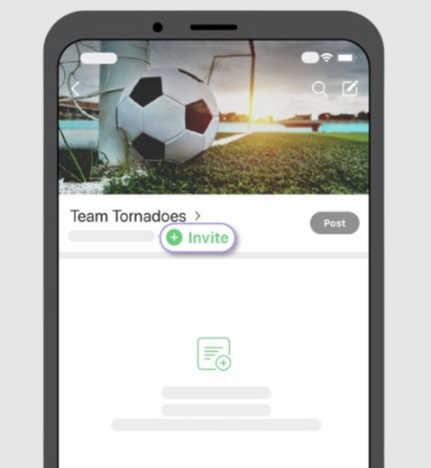
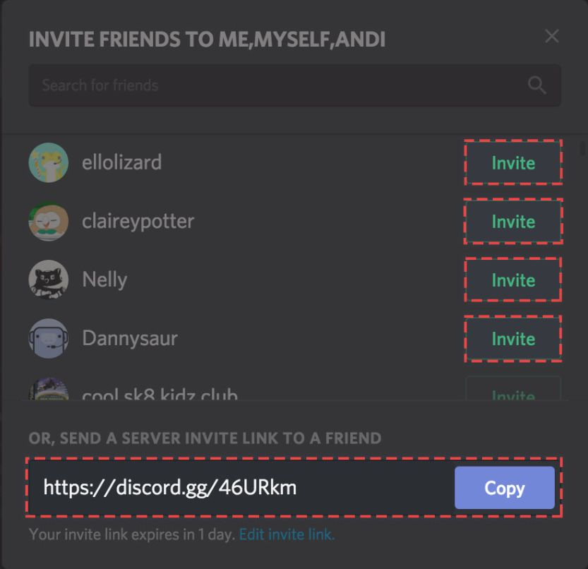

BAND는 모임 표지 아래에 초대 버튼을 둔다. Discord는 초대할 친구를 찾는 목록과 링크 복사를 한 화면에 보여준다. [BAND 초대 보내기 안내](https://blog.band.us/2022/03/15/easy-ways-to-invite-members-to-band/), [Discord 친구 초대 안내](https://support.discord.com/hc/en-us/articles/204155938-How-do-I-invite-friends-to-my-server)

**Runary에서 비교할 안**은 크루 이름 옆 `초대`를 눌러 링크를 바로 공유하는 방식과, `링크 공유`와 `회원 찾아 초대`를 한 시트에 두는 방식이다. 링크는 아직 Runary를 쓰지 않는 사람에게도 보낼 수 있다. 회원 검색은 상대 계정을 아는 경우에 쓰고, 동명이인을 구분할 수 있도록 프로필 사진과 공개 식별자를 보여주는 안을 검토한다. 친구 목록에서 바로 고르는 흐름은 친구 기능을 도입할 경우의 후보로 둔다.

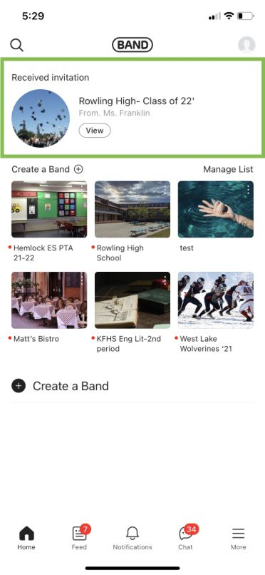
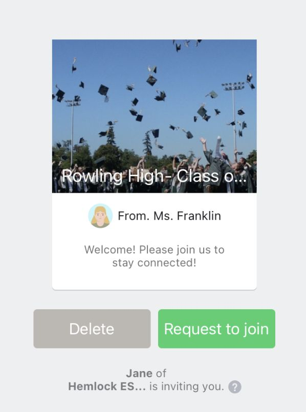

BAND의 받은 초대에는 모임과 초대한 사람이 먼저 보인다. `보기`를 누르면 초대 내용을 확인하고 가입을 요청할 수 있다. [BAND 받은 초대 안내](https://blog.band.us/2022/02/28/where-to-find-received-invitations-on-band/)

**Runary에 적용**할 때는 앱 안에서 받은 초대도 링크로 받은 초대와 같은 크루 소개 화면으로 연결한다. 확인할 수 있는 경우에는 누가 보냈는지도 보여준다. 로그인 전에는 초대받은 크루 이름을 확인하고, 로그인 뒤에는 같은 초대로 돌아오는 흐름을 본다. 자동 공유 여부는 가입을 마친 뒤 미리보기에서 따로 선택한다. [크루 기획서의 시안 흐름](../specs/prd/crew.md#시안으로-확인할-흐름)

### 크루를 검색하고 가입하기

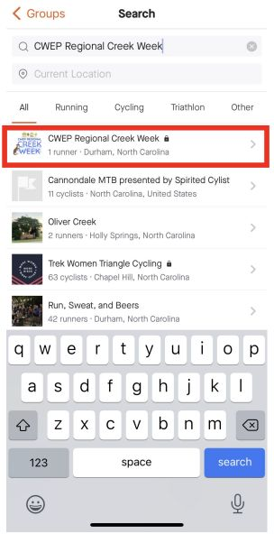

Strava 모바일 앱은 이름을 검색하고 지역이나 종목으로 결과를 좁힐 수 있다. 캡처는 2022년 CWEP 행사 가이드의 앱 화면으로, 결과에 크루 이름과 지역, 멤버 수, 가입이 제한된 크루 표시가 함께 보인다. [Strava 모바일 클럽 안내](https://support.strava.com/en-us/articles/15401837-clubs-on-the-mobile-app), [CWEP 가이드 5쪽](https://www.wakeforestnc.gov/sites/default/files/uploads/Engineering/strava_faq.pdf#page=5)

**Runary에 적용**할 때는 이름을 아는 사람을 위한 `크루 이름 검색`과 둘러보고 싶은 사람을 위한 `크루 찾기` 첫 화면을 비교한다. 검색 결과에는 이름, 대표 이미지, 멤버 수와 `바로 가입` 또는 `승인 필요`를 표시하는 안을 그린다. 지역 필터는 해당 크루가 공개한 지역 정보가 있을 때 비교하고, 검색 결과가 없으면 검색어 지우기와 전체 목록으로 돌아가는 길을 보여준다.

가입은 `가입하기`를 누르면 곧바로 멤버가 되는 안과, `가입 신청`을 누른 뒤 `승인 대기 중`을 보여주는 안으로 비교한다. 검색이나 초대로 상세에 다시 들어왔을 때도 현재 상태를 읽을 수 있게 한다. 어떤 크루에 승인 절차가 필요한지는 시안을 비교한 뒤 정한다. [Meetup 가입 절차](https://help.meetup.com/hc/en-us/articles/39234752483853-Joining-a-Meetup-group)

### 가입 전후 크루 상세

| 가입 전 | 가입 완료 후 |
|---|---|
| 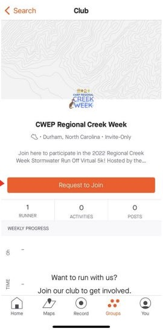 | 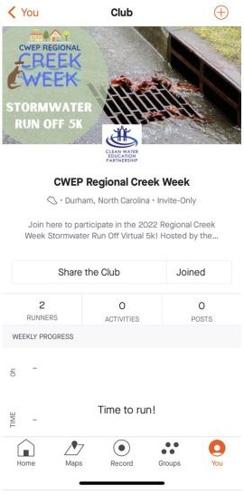 |

CWEP 가이드의 두 화면은 같은 Strava 크루다. 이름과 소개는 위쪽에 남고, 가입 신청 버튼이 가입 완료 표시와 크루 공유 버튼으로 바뀐다. Strava 모바일 클럽 안내에는 상세에서 멤버와 활동 목록을 여는 방법도 나와 있다. [CWEP 가이드 6쪽](https://www.wakeforestnc.gov/sites/default/files/uploads/Engineering/strava_faq.pdf#page=6), [Strava 모바일 클럽 상세](https://support.strava.com/en-us/articles/15401837-clubs-on-the-mobile-app)

| 가입 상태 | Runary 상세 화면 제안 |
|---|---|
| 가입 전 | 대표 이미지, 크루 이름, 한 줄 소개, 멤버 수와 가입 버튼을 보여준다. 비멤버에게는 크루가 공개한 소개 정보까지만 보인다. |
| 승인 대기 중 | 같은 소개 화면에서 버튼 자리에 `승인 대기 중`을 표시한다. 언제든 다시 들어와 신청 상태를 확인할 수 있다. |
| 가입 완료 | 같은 크루 이름 아래에 최근 공유 기록과 멤버 목록을 연다. 초대 버튼과 내 공유 설정으로 가는 위치도 비교한다. 공유된 기록이 없다면 상태 안내와 공유 미리보기로 가는 버튼을 보여준다. |

**시안에서 비교할 것**은 가입 후 `최근 러닝`이 바로 보이는 구성과 `소개`와 `기록`을 탭으로 나누는 구성이다. 기록을 바로 보여주면 최신 러닝까지 한 번에 갈 수 있고, 탭으로 나누면 소개를 다시 찾기 쉽다. 두 안 모두 다른 멤버의 기록은 가입한 사람에게만 보이게 한다. [크루 기획서의 공유 범위](../specs/prd/crew.md#공유-범위와-위치-가리기)

## 가입할 크루를 확인하는 화면

### Discord 초대 수락

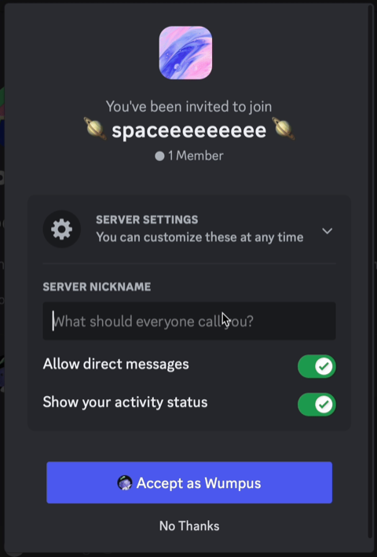

**볼 부분**은 초대받은 모임을 확인한 뒤 수락하는 순서다. 초대를 보낼 때는 친구 목록에서 직접 고르거나 링크를 복사할 수 있다. [Discord 초대 받기](https://support.discord.com/hc/en-us/articles/360034842871-How-do-I-join-a-Server), [Discord 친구 초대](https://support.discord.com/hc/en-us/articles/204155938-How-do-I-invite-friends-to-my-server)

**Runary에 적용**할 때는 링크와 회원 검색 초대를 같은 크루 소개 화면으로 연결한다. 크루 이름, 한 줄 소개, 멤버 수, 가입 버튼을 먼저 보여주고 로그인 뒤에도 그 초대로 돌아오는 흐름을 확인한다. 친구 목록 초대도 친구 기능을 도입할 경우에 같은 소개 화면으로 연결하는 후보로 둔다.

### 러닝라이프 크루 찾기

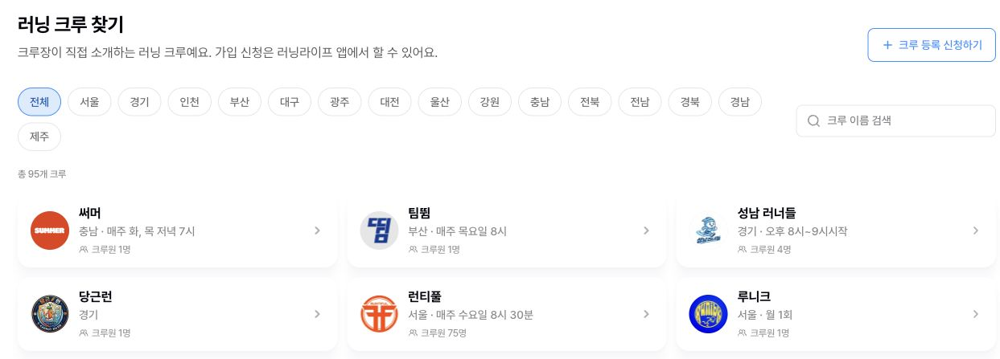

**볼 부분**은 이름 검색과 지역 필터, 결과 카드의 크루 이름과 활동 시간, 멤버 수다. [러닝라이프 크루 찾기](https://runninglife.co.kr/crews)

**Runary에 적용**할 때는 목록에 크루 이름, 한 줄 소개, 멤버 수, 가입 방식을 넣는다. 지역이나 모임 시간은 크루가 직접 등록한 경우에 보조 정보로 보여주는 안을 비교한다.

### Meetup 크루 소개와 가입

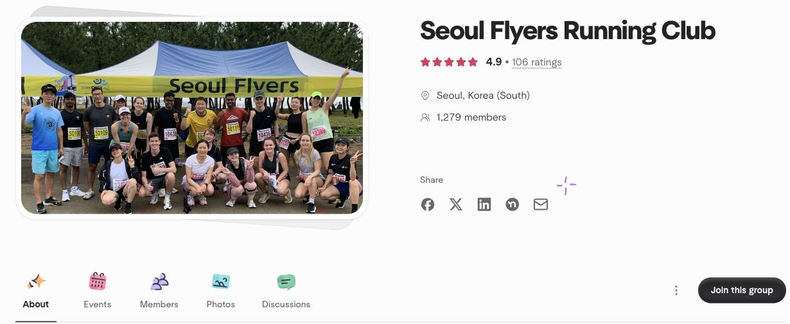

**볼 부분**은 처음 온 사람이 크루 이름과 사진, 지역, 멤버 수를 보고 가입을 결정할 수 있게 한 구성이다. Meetup은 운영자가 회원 승인을 켜둔 그룹에서 가입 요청 뒤 승인을 기다리도록 안내한다. [Seoul Flyers Running Club 소개](https://www.meetup.com/seoul-flyers/), [Meetup 가입 절차](https://help.meetup.com/hc/en-us/articles/39234752483853-Joining-a-Meetup-group)

**Runary에 적용**할 때는 초대 카드와 소개가 있는 상세 화면을 비교한다. 짧은 초대 카드는 크루를 이미 아는 사람에게 빠르고, 소개 화면은 앱에서 처음 발견한 크루를 살펴보기에 좋다. 승인제를 택할 경우 `가입 신청`과 `승인 대기`를 별도 상태로 그린다.

### BAND 검색과 멤버 공개 범위

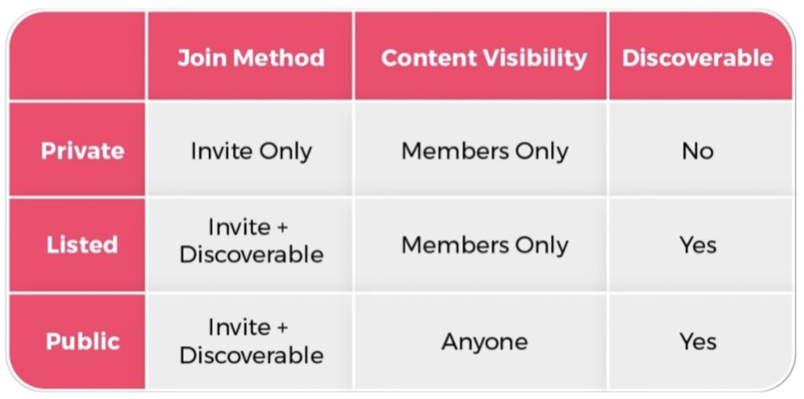

**볼 부분**은 검색으로 모임을 발견할 수 있어도 모임 안의 글은 멤버에게만 보이는 방식이다. [BAND 모임 공개 범위 안내](https://blog.band.us/2022/01/19/how-many-groups-create-band-app/)

**Runary에 적용**할 때는 탐색과 가입 전 소개에 크루가 등록한 정보만 둔다. 검색으로 찾을 수 있는 크루에서도 멤버의 러닝 기록은 가입 후에 볼 수 있다. 소개 화면에 넣을 정보와 가입 후 열리는 정보를 비교표에 따로 표시한다.

## 크루 홈과 기록 상세

### Strava 피드 카드

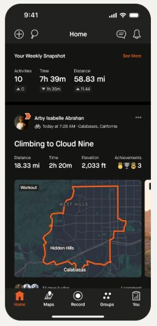

**볼 부분**은 사용자 이름과 주요 수치가 먼저 읽히고 경로가 이어지는 카드 배치다. 기록을 누르면 상세가 열린다. [Strava 공식 화면](https://press.strava.com/articles/available-today-strava-releases-dark-mode), [Strava 기록 상세](https://support.strava.com/en-us/articles/15401981-viewing-activities)

**Runary에 적용**할 때는 닉네임과 날짜, 거리와 시간, 평균 페이스를 넣고 지도 없이 경로 모양을 보여준다. 같은 기록으로 경로를 넓게 보여주는 카드와 오른쪽에 작은 썸네일을 두어 여러 기록을 훑기 쉬운 카드를 비교한다.

### Apple 피트니스 멤버별 활동

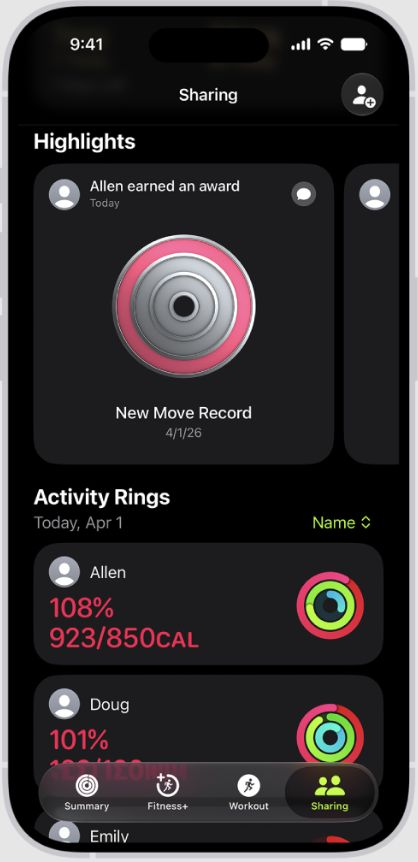

**볼 부분**은 기록 한 건이 아니라 사람별로 활동을 훑을 수 있는 목록이다. [Apple 피트니스 활동 공유 안내](https://support.apple.com/ko-kr/guide/iphone/iph0b826155d/ios)

**Runary에 적용**할 때는 멤버마다 최근 공유한 러닝 한 건과 거리, 작은 경로 모양을 한 줄에 담는다. 자주 뛰는 한 사람이 홈 대부분을 채우는 것을 줄일 수 있다. 같은 멤버의 이전 러닝을 보려면 한 번 더 들어가야 하므로 최신 기록순 피드와 함께 비교한다.

### Corsa 최근 활동 요약

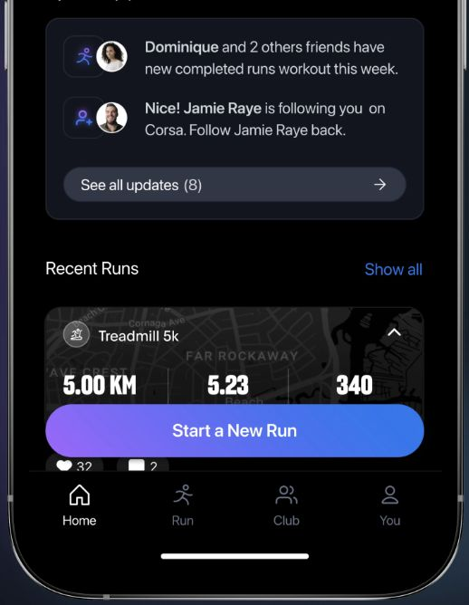

**볼 부분**은 화면 위쪽에 최근 소식을 짧게 모으고 아래에서 기록을 보여주는 구성이다. [Corsa 디자인 사례](https://www.rasa.team/work/corsa)

**Runary에 적용**할 때는 첫 줄에 `오늘 크루원 3명이 달렸어요`처럼 공유된 활동을 한 문장으로 요약하고, 이어서 최신 러닝을 보여주는 안을 그린다. 기록이 적을 때도 크루 분위기를 전달할 수 있지만, 요약이 길면 첫 기록이 아래로 밀린다.

### Run Receipt 지도 없는 경로 모아보기

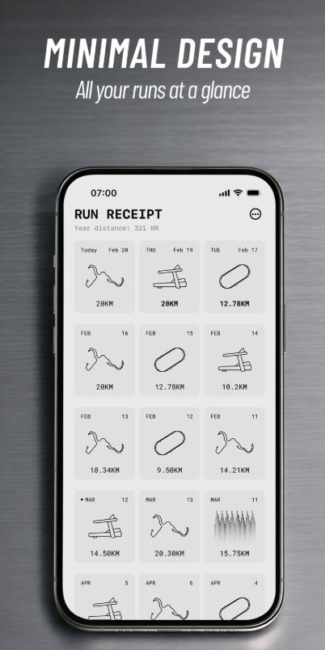

**볼 부분**은 지도가 없어도 서로 다른 경로의 모양을 한눈에 비교할 수 있다는 점이다. [Pinterest의 Run Receipt 화면](https://kr.pinterest.com/pin/123004633572556976/), [Run Receipt 공식 사이트](https://receipt.atomicos.run/)

**Runary에 적용**할 때는 두 열의 카드에 경로 모양을 크게 두고 닉네임과 거리를 함께 표시한다. 카드 한 장에 들어가는 정보가 적으므로 시간과 평균 페이스는 기록 상세에서 읽기 좋게 보여준다. 누구의 기록인지 쉽게 찾을 수 있는지 최신 기록순 목록과 비교한다.

### Everyday 사진과 경로를 담은 기록

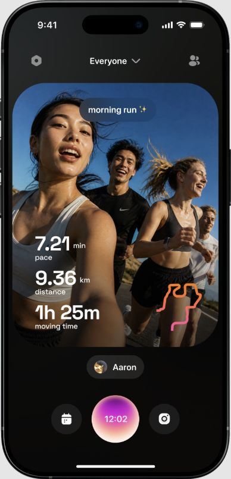

**볼 부분**은 사진 속 달리는 모습과 지도 없는 경로, 주요 수치를 함께 보여주는 카드다. [Everyday 공식 사이트](https://runeveryday.club/), [Pinterest의 Everyday 화면](https://kr.pinterest.com/pin/1143984742879838328/)

**Runary에 적용**할 때는 멤버가 직접 사진을 넣은 기록이나 추천 기록 한 건을 크게 보여주는 안으로 본다. 최근 기록 전체를 이 크기로 놓으면 훑기 어렵다. 사진이 없을 때도 경로 모양과 수치가 자연스럽게 읽히는 구성을 함께 확인한다.

### Pinterest 러닝 소개와 기록 상세 콘셉트

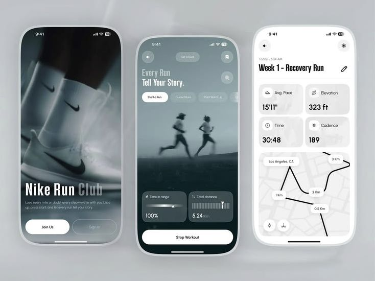

**볼 부분**은 왼쪽 화면의 러닝 사진과 짧은 문구, 오른쪽 화면의 나뉜 수치와 경로 영역이다. [Pinterest의 Nike Run Club 디자인 콘셉트](https://kr.pinterest.com/pin/140315344637771870/)

**Runary에 적용**할 때는 크루 소개에 사진을 넣는 안을 비교한다. 기록 상세에서는 경로 아래에 전체 거리를 크게, 시간과 평균 페이스를 작게 배치한다.

### Pinterest 어두운 지도와 주황 경로 콘셉트

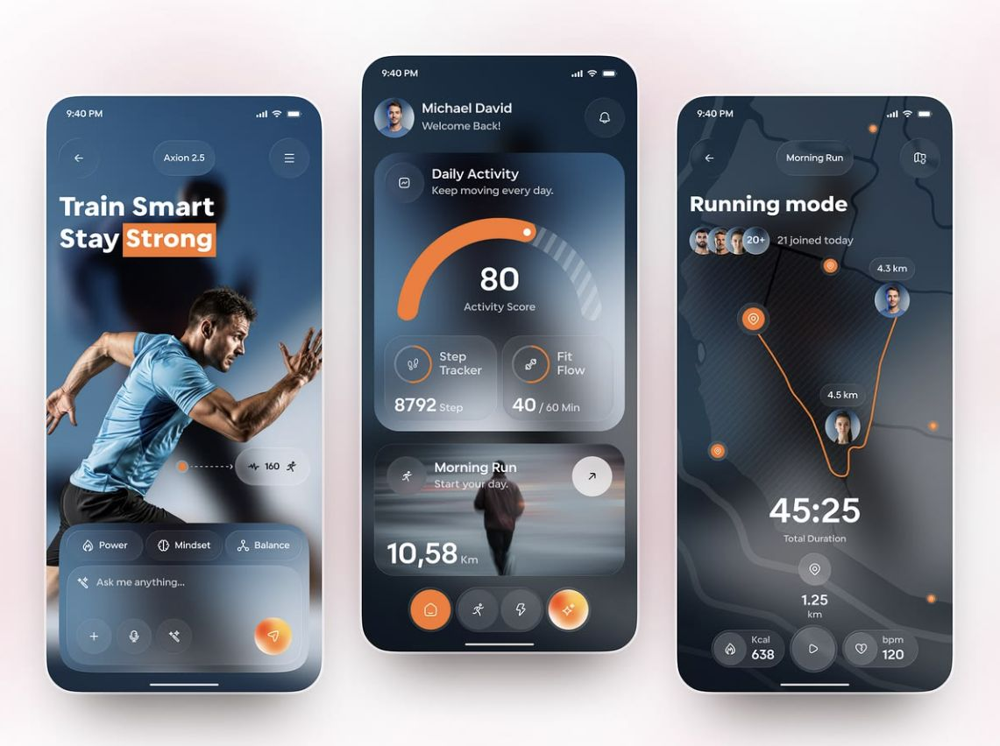

**볼 부분**은 오른쪽 화면에서 지도 배경보다 주황 경로가 선명하게 읽히는 대비다. [Dribbble이 Pinterest에 공유한 디자인 콘셉트](https://kr.pinterest.com/pin/594475219605809760/)

**Runary에 적용**할 때는 지도 보기에 공개된 구간을 눈에 띄게 그린다. 카드와 버튼, 글꼴과 거리 표기는 지민님의 디자인 시스템을 적용한다. [Runary 디자인 시스템](https://github.com/everyware-ie/run-mechuri/pull/137)

## 공유 미리보기와 위치 숨기기

### Strava 지도 공개 설정

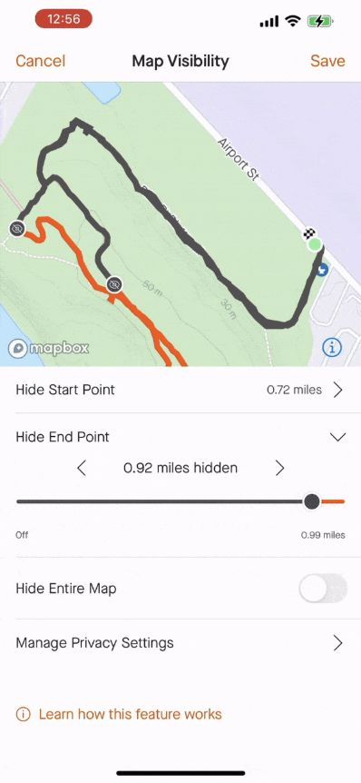

**볼 부분**은 본인용 편집 화면의 주황색 공개 구간과 회색 숨김 구간이다. 아래에서 출발점과 도착점 주변을 각각 조절할 수 있다. Strava는 기본 공개 범위와 기록별 설정을 제공한다. [Strava 공식 화면 예시](https://communityhub.strava.com/insider-journal-9/hiding-your-activity-map-from-others-1516), [Strava 지도 공개 설정](https://support.strava.com/en-us/articles/15402012-how-do-i-edit-my-map-visibility-on-strava)

**Runary에 적용**할 때는 ‘크루원에게 이렇게 보여요’ 아래에 크루원이 받을 카드를 그대로 보여준다. 자동 공유를 켜기 전에 공유 대상과 항목을 확인하고, ‘나중에’도 선택할 수 있도록 그린다.

지도와 평균 심박수는 각각 별도 선택으로 둔다. 지도 공유를 켜면 출발점과 도착점 주변, 지정한 구간을 뺀 지도 미리보기로 바뀐다. 숨긴 구간은 크루원 화면의 선에서도 빠지며, 전체 거리와 시간은 그대로 보인다. 기록 상세의 기본 보기는 좌표와 장소 이름이 없는 ‘경로 모양’이고, 공개된 지도 구간이 있을 때 ‘지도’ 보기로 전환할 수 있게 그린다. 경로 모양까지 숨기면 수치만 남는 상태도 확인한다.

### Ride with GPS 숨길 장소와 범위 지정

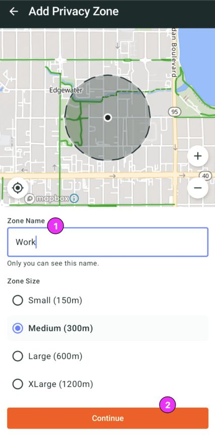

**볼 부분**은 가릴 범위를 지도에서 바로 확인하고 크기를 고르는 방식이다. 장소 이름은 본인에게만 보인다고 입력란 아래에 적혀 있다. [Ride with GPS 위치 숨기기 안내](https://support.ridewithgps.com/hc/en-us/articles/4419030783643-Privacy-Zones)

**Runary에 적용**할 때는 지도 공유를 켠 사람이 필요한 경우 `숨길 장소 추가`를 열어 집이나 회사 주변을 미리 가리는 안을 그린다. 지도 공유 없이 경로 모양만 쓰는 사람은 미리보기에서 바로 결정을 마칠 수 있다. ‘크루원에게 이렇게 보여요’ 화면에서는 숨긴 영역 자체와 장소 이름도 보여주지 않는다.

## 크루장에게 가입 신청 알리기

2026-11-16 현수가 크루 홈의 [>]에 가입 신청 건수를 붙이자고 해서 찾아봤다. 화면 캡처는 받지 못했고 도움말과 검색 요약을 근거로 했다.

| 서비스 | 신청을 보는 곳 | 알림 | 근거 |
|---|---|---|---|
| Strava 클럽 | 비공개 클럽의 관리자가 클럽의 Pending Requests에서 승인하거나 거절한다 | 앱 설정에서 가입 요청 푸시를 켤 수 있다 | [Strava 모바일 클럽 도움말](https://support.strava.com/hc/en-us/articles/221622188-Clubs-on-the-Mobile-App). 이 환경에서 페이지를 열지 못해 검색 요약으로 봤다 `[확인 필요]` |
| Instagram 비공개 계정 | 활동 화면 맨 위의 팔로우 요청 줄 | 요청이 오면 계정 주인에게 알림이 간다 | 공식 도움말이 아닌 [안내 글](https://www.bustle.com/life/instagram-follow-request-folder) `[확인 필요]` |
| Facebook 그룹 | 관리자 도구의 개요에서 대기 중인 가입 요청 수를 본다 | 그룹 관리에서 요청 알림을 켤 수 있다 | 공식 [Graph API](https://developers.secure.facebook.com/docs/reference/api/group)에 대기 중인 가입 요청 수 필드(`member_request_count`)가 있다. 화면 설명은 [제3자 안내 글](https://groupboss.io/blog/facebook-group-admin-tools/amp/)이다 `[확인 필요]` |
| BAND | 리더가 밴드 설정에서 가입 신청을 켜면 리더가 승인해야 가입된다 | 찾지 못했다 | [안내 글](https://specialmanual.com/%EB%84%A4%EC%9D%B4%EB%B2%84-%EB%B0%B4%EB%93%9C-%EB%A7%8C%EB%93%A4%EA%B8%B0-%EB%B0%8F-%EC%82%AC%EC%9A%A9%EB%B2%95-3%EA%B0%80%EC%A7%80-%EB%AA%A8%EC%9E%84-%EA%B0%9C%EC%84%A4-%EC%9A%B4%EC%98%81/) `[확인 필요]` |

Apple 가이드라인에서 배지에 관해 정한 것은 아래와 같다.

- 배지는 숫자를 담은 작은 타원이다. 확인하지 않은 알림 수를 보여 줄 때 쓰고, 처리하면 사라졌다가 새 알림이 오면 다시 나타난다. 배지만으로 중요한 정보를 알리지 않는다. [HIG 알림](https://developer.apple.com/design/human-interface-guidelines/notifications)
- 탭 막대의 배지는 주의가 필요한 새 정보가 있을 때만 붙인다. 자주 붙이면 뜻이 흐려진다. [HIG 탭 막대](https://developer.apple.com/design/human-interface-guidelines/tab-bars)
- 배지는 목록 줄, 탭 막대, 도구 막대, 메뉴에 붙는다. [SwiftUI badge](https://developer.apple.com/documentation/swiftui/view/badge%28_%3A%29-8adyq)

**Runary에 적용**할 때는 아이콘 버튼인 [>] 오른쪽 위에 숫자 원을 붙인다. 앱 아이콘과 탭 막대의 배지와 같은 자리라 익숙하다. 숫자는 처리하지 않은 신청 수이고 모두 처리하면 배지가 사라진다. 색은 Apple 기본인 빨강 대신 디자인 시스템의 강조색(주황)을 썼다.

살펴본 서비스는 배지 하나보다 관리 화면과 푸시 알림으로 신청을 알린다. 크루장이 크루 탭을 열지 않으면 배지를 보지 못한다. 하단 크루 탭 배지와 새 신청 푸시 알림을 둘지는 따로 정한다. 크루 기획서는 알림을 참여 흐름이 자리 잡은 뒤로 미뤄 두었다.

## 시안을 보면서 정할 것

1. 기존 크루원이 링크를 보내는 경우와 처음 온 사람이 앱에서 크루를 검색하는 경우를 각각 본다. 두 경로가 같은 크루 상세로 모이는지, `가입 신청`과 `승인 대기 중`이 쉽게 구분되는지 확인한다. 회원 검색과 친구 목록 초대는 사람을 고르는 부분을 비교한다.
2. 예시 크루 하나에 멤버 4명과 공유 기록 8건을 넣고 홈을 비교한다. 최근 누가 뛰었는지 빠르게 보려면 멤버별 요약, 달린 경로의 모양을 먼저 보고 싶다면 경로 모아보기가 유리한지 확인한다. 기록이 없는 첫 화면도 함께 본다.
3. 같은 러닝으로 지도 없는 경로 모양, 민감한 구간이 빠진 지도, 경로 모양을 숨긴 요약을 비교한다. 멤버에게 실제로 보이는 구간과 별도 선택이 필요한 항목을 화면만 보고 설명할 수 있는지 확인한다.
