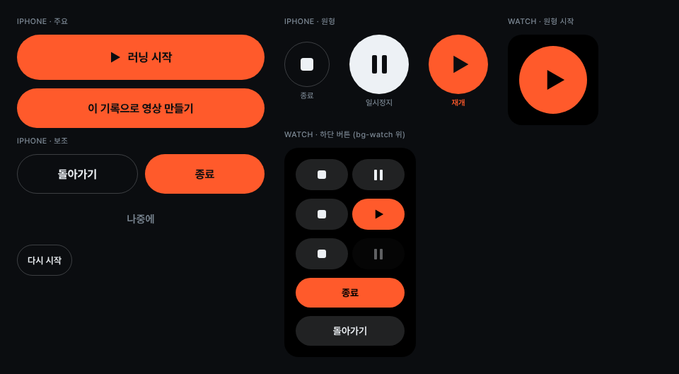

# Button

러닝을 시작·재개·종료하는 버튼입니다. 아이폰은 주요·보조·글자·원형 네 종류를 쓰고, 워치는 채운 버튼과 원형 시작 버튼 두 종류를 씁니다.

## 아이폰
- **주요**: `.btn.btn--primary`, 바탕 `accent`, 글자 `bg`. ‘러닝 시작’은 `.btn--start`(높이 `size-btn-start` 64, 17px/700, 앞에 16×18 ▶)를 씁니다. 시트와 하단 고정 버튼은 `.btn--lg`(56, 16px/700)를 씁니다.
- **보조**: `.btn--secondary`, 테두리 1px `line`. 종료 시트에서는 주요 버튼과 반씩 나눠 왼쪽에 둡니다(돌아가기 | 종료).
- **글자**: `.btn--text`(48, 15px/600, `muted`). ‘나중에’처럼 넘어가는 동작에 씁니다.
- **인라인**: `.btn--inline`(44, 13px/600, 테두리 `line`). 안내 카드 오른쪽 ‘다시 시작’에 씁니다.
- **원형**: 하단 컨트롤은 [종료 64 외곽선] [가운데 84] [64 빈 칸] 순서로, 간격은 `space-28`입니다. 가운데 버튼은 러닝 중에는 `text` 바탕에 ❙❙, 일시정지 중에는 `accent` 바탕에 ▶입니다. 라벨은 11px `muted`이고, ‘재개’만 600 + `accent`입니다.

## 워치
- 하단 버튼은 `.wbtn`(44, 바탕 `fill-button`)입니다. 두 개를 `space-6` 간격으로 놓고 종료는 왼쪽, 일시정지·재개는 엄지가 닿는 오른쪽에 둡니다.
- 강조할 버튼은 하나만 `.wbtn--accent`로 둡니다(재개, 종료 확인). 아이콘과 글자는 `bg-watch`(#000)입니다.
- 막힌 버튼은 `.wbtn--disabled`(바탕 `fill-tile`, `opacity-disabled`)로 표시합니다. 연결 확인 중의 일시정지가 해당됩니다.
- 종료 확인 화면에서는 `.wbtn--confirm`(42) 두 개를 세로로 놓습니다. 주황 ‘종료’가 위, ‘돌아가기’가 아래입니다.
- 시작은 `.wstart`(96 원형, `accent`)이고 그 아래 ‘러닝 시작’(w-start)을 둡니다.

## 하지 말 것
- 한 화면에 주황 버튼을 둘 이상 두지 않습니다.
- 버튼을 화면 위쪽에 두지 않습니다. 실수로 누르기 쉽습니다(시안 W7).
- 아이폰 반영이 확인되기 전에는 누른 버튼을 다시 누를 수 없게 합니다. 시안에는 ‘처리 중’ 표시의 모양이 아직 정해져 있지 않습니다.

