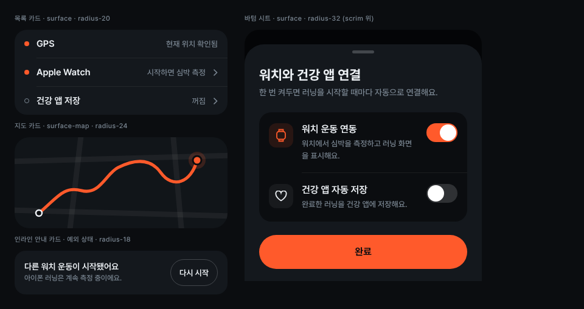

# Card

아이폰 화면에서 정보를 묶는 바탕입니다. 목록 카드, 지도 카드, 안내 카드, 바텀 시트 네 가지가 있으며 워치에서는 쓰지 않습니다.

- **목록 카드** `.card`: 바탕 `surface`, `radius-20`. 행 `.row`는 패딩 14/16, 최소 높이 44입니다. 행 사이 구분선 `.hr`(`divider`)은 왼쪽을 36px 들여씁니다(번호 아이콘이 있으면 46, 40px 타일이 있으면 70). 행 왼쪽 상태 점은 켜짐이면 `.dot`, 꺼짐이면 `.dot--off`이고, 누를 수 있는 행에만 오른쪽 셰브런을 붙입니다.
- **시트 안 목록**은 `.card--inset`(바탕 `bg`)을 씁니다. `surface` 시트 위에서 한 단계 내려가 보입니다.
- **지도 카드** `.map`: 바탕 `surface-map`, `radius-24`. 도로는 `fill-tile` 굵은 선, 경로는 `accent` 5px 둥근 선입니다. 출발점은 `bg` 채움에 `text` 테두리, 현재 위치는 `accent` 점에 `accent-halo-map` 원입니다. 일시정지 중에는 현재 위치 점을 `text`로 바꾸고 카드에 `opacity-paused-map`을 줍니다.
- **안내 카드** `.alert`: `surface`, `radius-18`. 예외 상태일 때 지도 아래 안내 한 줄 자리가 이 카드로 커집니다. 제목 14/600, 설명 12/500 `muted`, 오른쪽에 `.btn--inline` 하나를 둡니다.
- **바텀 시트** `.sheet`: `surface`, 위 모서리 `radius-32`, 좌우 패딩 24, 블록 간격 22. 뒤 화면은 `scrim`으로 덮습니다. 맨 위 손잡이는 36×5 `line`입니다. 시스템 Alert 대신 시트를 씁니다(연결 설정, 종료 확인).

넣는 쪽이 정할 것: 행의 이름·값 문구, 누를 수 있는지 여부, 지도 경로 데이터.

