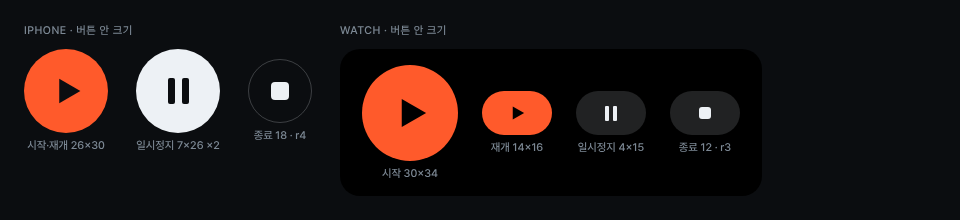

# ControlIcon

시작 ▶, 일시정지 ❙❙, 종료 ■ 아이콘입니다. 아이콘 폰트나 SF Symbols 대신 시안의 도형을 그대로 그립니다.

| 아이콘 | 아이폰 | 워치 | 도형 |
|---|---|---|---|
| 시작·재개 ▶ | 원형 버튼 26×30, 글자 버튼 16×18 | 시작 30×34, 재개 14×16 | `M2 1.5v15l13-7.5z`(viewBox 16×18), 가운데에서 오른쪽으로 2~5px 옮김 |
| 일시정지 ❙❙ | 7×26 막대 2개, 간격 7, r2 | 4×15 막대 2개, 간격 4, r1 | `.i-bar` / `.i-bar--w` |
| 종료 ■ | 18×18, `radius-4` | 12×12, r3 | `.i-stop` / `.i-stop--w` |

- 색은 버튼 바탕에 따라 정합니다. `accent`·`text` 바탕 위에서는 아이폰 `bg`, 워치 `bg-watch`를 쓰고, 어두운 바탕 위에서는 `text`를 씁니다.
- 상태 라벨 안의 작은 일시정지(아이폰 3×10, 워치 2.5×9)는 `StatusLabel`에 속합니다.
- 함께 쓰는 보조 글리프: 하트(심박), 워치 외곽, 체크 원(저장됨), 스피너(확인 중), 셰브런. 모두 시안 SVG 경로를 그대로 씁니다.

