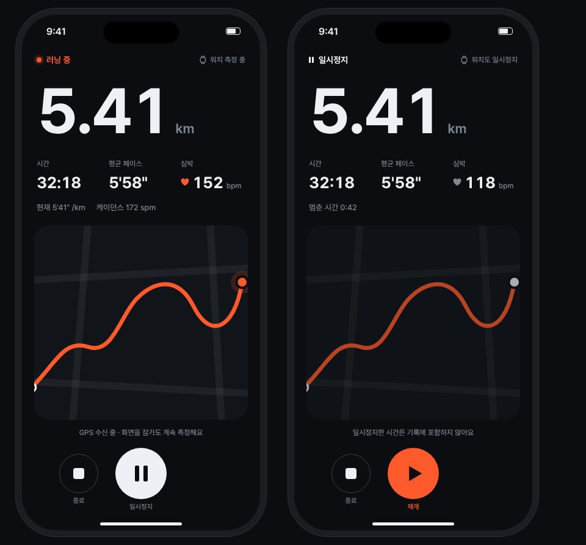

# IPhoneScreen

아이폰 러닝 화면(390×844) 예시입니다. 위에서 아래로 상태 줄, 거리, 3지표, 보조 줄, 지도, 안내 한 줄, 원형 컨트롤 순서입니다.

- 좌우 여백은 글자·수치 영역이 `space-24`, 지도 같은 카드 영역이 `space-20`입니다.
- 세로 간격은 상태→거리 26, 거리→3지표 28, 3지표→보조 줄 18, 보조 줄→지도 22, 지도→안내 14, 안내→컨트롤 18입니다.
- 지도가 남은 높이를 모두 차지합니다(flex 1). 그래서 기기 높이가 달라져도 거리와 버튼 위치가 흔들리지 않습니다.
- 안내는 지도 아래 한 줄(`ip-label`, 가운데 정렬)에만 둡니다. 예외 상태에서는 이 자리가 `Card`의 `.alert`로 커집니다.
- 러닝 중에서 일시정지로 바뀌면 상태 줄, 심박 아이콘 색, 보조 줄 문구, 지도 투명도, 안내 문구, 가운데 버튼만 바뀝니다.

