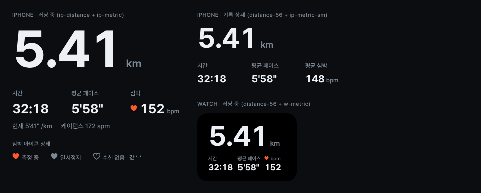

# MetricBlock

거리 하나를 크게, 그 아래에 시간·평균 페이스·심박을 3열로 보여주는 지표 묶음입니다. 아이폰과 워치는 순서가 같고 크기만 다릅니다.

| 쓰는 곳 | 거리 | 단위 | 3지표 | 라벨 | 열 비율 |
|---|---|---|---|---|---|
| 아이폰 러닝 중·일시정지 | `ip-distance` 104 | `ip-unit` 22 | `ip-metric` 26 | `ip-label` 12 | 1 : 1 : 1, 간격 12 |
| 아이폰 기록 상세 | `distance-56` | `ip-unit-sm` 18 | `ip-metric-sm` 20 | `ip-label` 12 | 1 : 1 : 1 |
| 워치 | `distance-56` | `w-unit` 14 | `w-metric` 17 | `w-label` 10 | 1.1 : 1 : 0.9, 간격 6 |

- 수치에는 모두 `font-variant-numeric: tabular-nums`(`.num`)를 적용합니다. 초가 바뀌어도 글자 폭이 흔들리지 않습니다.
- 페이스는 `5'58"` 형식, 시간은 `32:18` 형식으로 씁니다. 단위는 수치 옆에 `muted`로 붙입니다.
- 심박 아이콘은 측정 중이면 `accent` 채움, 일시정지면 `muted` 채움, 수신이 없으면 `muted` 빈 하트에 값 ‘-’입니다.
- 아이폰에서만 3지표 아래에 보조 줄 `.sub-line`(13/500 `muted`)을 둡니다. 현재 페이스·케이던스를 넣고, 일시정지 중에는 ‘멈춘 시간’, 측정 중단 때는 ‘마지막 심박 34:10’을 넣습니다. 워치에서는 케이던스를 두 번째 페이지로 보냅니다.
- 연결 확인 중에는 거리와 3지표를 `opacity-stale`로 흐리게 고정합니다. 값을 추정해서 늘리지 않습니다.

넣는 쪽이 정할 것: 거리(km, 소수 둘째 자리), 경과 시간, 평균 페이스, 심박(없으면 null → ‘-’).

