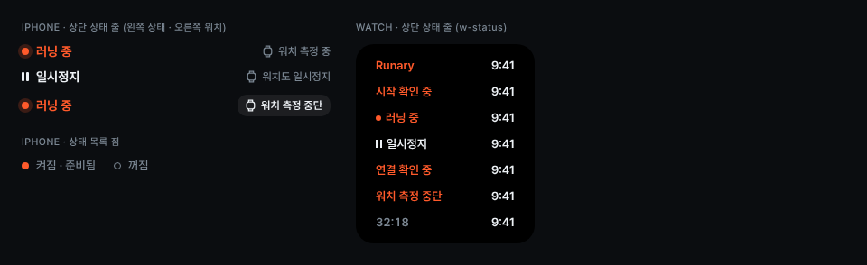

# StatusLabel

화면 맨 위 한 줄로 지금 러닝이 어떤 상태인지 알려주는 라벨입니다. 상태가 바뀌면 이 줄과 하단 영역만 바뀌고, 지표 배치는 그대로 둡니다.

## 아이폰 `.status` (14/700)
- 러닝 중: `accent` 글자와 8px 점, 점 바깥에 `accent-ring` 4px 링을 둡니다.
- 일시정지: `text` 글자에 3×10 막대 두 개를 둡니다.
- 오른쪽에는 워치 상태를 둡니다. 평소에는 `.status-aside`(12/500 `muted` + 워치 아이콘)로 ‘워치 측정 중’, ‘워치도 일시정지’를 씁니다. 예외일 때만 `.chip`(바탕 `fill-chip`, `radius-10`, 12/600 `text`)으로 바꿉니다. ‘워치 측정 중단’, ‘연결 확인 중’, ‘워치 연결 필요’가 여기에 해당합니다.

## 워치 `.wstatus` (13/600)
- 왼쪽은 상태, 오른쪽은 시각입니다.
- 주황 글자는 사용자가 알아야 할 상태에 씁니다: Runary(대기·완료), 시작 확인 중, 러닝 중(6px 점 포함), 연결 확인 중, 워치 측정 중단.
- 일시정지는 `text` 글자에 2.5×9 막대 두 개를 둡니다.
- 종료 확인 화면에서는 상태 대신 경과 시간을 `muted`로 둡니다.

## 상태 목록 점 (시작 전)
켜짐·준비됨은 `accent` 채운 점, 꺼짐은 1.5px `muted` 빈 점입니다. 색만으로 구분하지 않도록 행 오른쪽에 상태 문구를 함께 둡니다.

