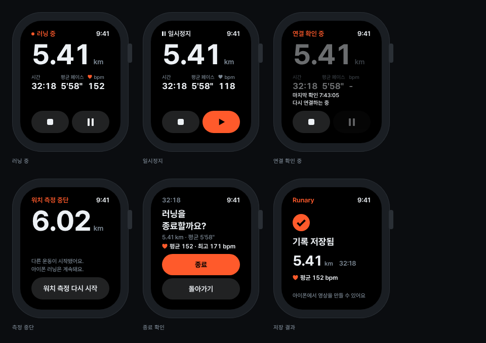

# WatchScreen

애플워치 45mm(198×242pt) 화면 예시입니다. 상단 상태, 지표, 하단 버튼의 세 칸 구조이고, 상태 6종을 모두 담았습니다.

- 화면 패딩은 위 `space-18`, 좌우 `space-22`, 아래 `space-20`, 바탕은 `bg-watch`입니다.
- `.wzone-top`: 상태 줄 하나(`w-status`), 왼쪽은 상태, 오른쪽은 시각입니다.
- `.wzone-mid`: 거리(`distance-56`)와 3지표(`w-metric`)를 둡니다. 남는 공간은 아래로 밀어두고, 하단 바로 위에 안내 문구(`w-caption`)가 들어갈 수 있습니다.
- `.wzone-bot`: 높이 44 버튼 두 개(종료 | 일시정지·재개) 또는 한 개를 둡니다.
- 스크롤 없이 한 화면에 모두 들어가야 합니다. 케이던스 같은 추가 지표는 두 번째 페이지로 보냅니다.
- 상태가 바뀌어도 칸은 그대로입니다. 상단 라벨과 하단 영역만 바꿉니다. 종료 확인과 저장 결과처럼 지표 대신 요약이 들어가는 화면도 세 칸을 유지합니다.

