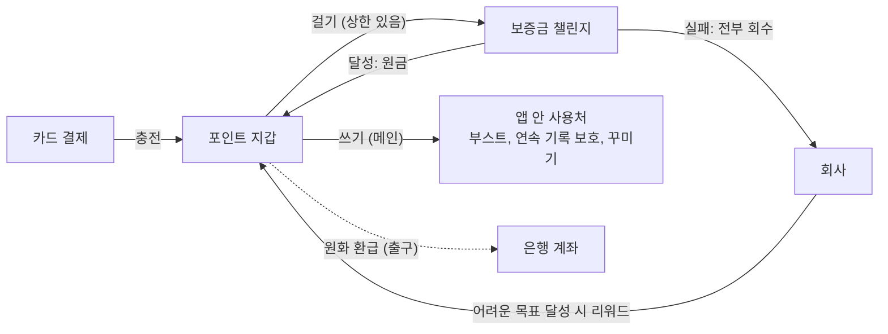

# 2026-11-10 보증금 챌린지와 포인트 BM 구상 (다음 스프린트 아이디어)

> 성격: 현수 개인 아이디어. **결정이 아니고 법률 검토 전이다.** 11/3 회의 뒤 "다음 스프린트에 대해 각자 생각해 오기"로 한 것의 하나로 정리했다.\
> 조사 기준일 2026-11-10. 조사와 정리는 Claude와 대화하며 했다.

**회의에서 화면으로 볼 도식은 [2026-11-10-deposit-challenge-bm.html](2026-11-10-deposit-challenge-bm.html)이다.** 내려받아 브라우저로 연다.\
이 노트는 같은 내용을 글로 남긴 원문이고, 출처는 여기에 모두 단다.

## 한 줄 요약

러닝 목표에 포인트를 걸고, 달성하면 돌려받는다. 어려운 목표를 달성하면 회사가 조금 더 얹어 주고, 실패하면 건 포인트는 회수한다.\
포인트는 앱 안에서 쓰는 것이 기본이고, 원화 환급은 떠나는 사람을 위한 출구로 둔다.

## 현수가 한 말 (대화 원문에서)

처음 구상:

> "결제해서 포인트를 구매하고 포인트로 어떤 토큰 같은 재화를 또 구매해서 사람이 특정 기간 동안 러닝 목표를 달성하고 토큰을 넣으면 넣은 러닝 목표와 토큰에 비례해서 달성하면 현금으로 구매한 토큰은 페이백해주고(아마 조금 더 얹혀서 줄 수 있음) 달성하지 못하면 그대로 사라지고 그런 보증금 + 환급형 보상 구조를 설계하는 것임."

> "토큰까지 굳이 필요 없다면 안 해도 되긴 함."

방향을 정하며:

> "도박처럼 보이지 않고 동기부여와 성취 보상을 해주는 개념으로 설계해야 합니다."

> "더 얹어 주는 건 당연히 회사 재원으로 감당하는 부분입니다." "(쉬운 난이도를 목표로 정했다면 더 얹어주지 않고 보증금 환급만)"

> "보증금도 최대 금액이 있고 리워드에도 최대 %가 당연히 있겠죠."

> "이걸로 떼 돈을 벌자 이런 마인드는 아니고 소소하게 파이를 키워가며 일단은 조금이라도 수익 실현을 해보는 게 목표죠."

> "보증금 챌린지 실패는 어떠한 포인트 리워드 없이 그대로 끝입니다."

## 지금 구조

| 규칙 | 내용 |
|---|---|
| 보증금 | 한 번에 걸 수 있는 금액에 상한을 둔다 |
| 리워드 재원 | 회사가 낸다. 남이 실패한 포인트로 주지 않는다 |
| 리워드 크기 | 난이도별 비율로 정하고 비율에도 상한이 있다. 쉬운 목표는 원금만 돌려준다 |
| 실패 | 리워드 없이 끝난다. 건 포인트는 전부 회수한다 |
| 원화 환급 | 보상으로 받은 포인트도 포함한다. 수수료는 정하지 않았다 |
| 판정 | Runary 측정 기록으로 한다. 건강 앱 기록은 손으로 입력할 수 있어서다 `[확인 필요]` |

### 난이도별로 돌아오는 것

| 난이도 | 돌아오는 것 |
|---|---|
| 쉬움 | 보증금 |
| 보통 | 보증금 + a% |
| 어려움 | 보증금 + b% |
| 실패 | 없음 |

a, b, 보증금 상한은 회의에서 정할 값이다.\
다른 서비스가 한 번에 걸 수 있게 한 최대치는 이렇다.

- 챌린저스: 예치금 20만원. 약관 페이지([biz-challengers.com/terms](https://biz-challengers.com/terms))를 직접 열지 못하고 검색 요약으로만 봤다 `[확인 필요]`
- 머니워크: 50,000포인트 ([머니워크 고객센터](https://docs.channel.io/moneywalk/ko/articles/%EB%8F%88-%EA%B1%B0%EB%8A%94-%EC%B1%8C%EB%A6%B0%EC%A7%80-14114d41))

## 포인트를 쓰는 곳

초반에는 러닝 용품을 팔기 어려우니 게임 요소로 사용처를 만든다.\
현수의 생각은 이렇다. 게임에 캐시를 충전해서 쓰듯 포인트를 쓰게 하면, 목표를 달성해서 돌려받는 구조가 덜 사행성으로 느껴진다.

| 사용처 | 시기 | 내용 |
|---|---|---|
| 경험치 부스트 | 초반 | 달린 거리만큼 경험치가 쌓이고, 부스트로 더 빨리 올린다 |
| 연속 기록 보호 | 초반 | 연속으로 달린 기록이 끊길 뻔할 때 막아 준다 |
| 캐릭터 꾸미기 | 초반 | 캐릭터를 만들고 꾸민다 |
| 러닝 용품 | 나중 | 포인트로 사고, 모자라면 차액만 카드로 낸다 |
| 소셜 기능 | 나중 | 소셜 기능을 도입하면 추가 이용에 포인트를 쓴다 |

### 지킬 경계: 성장 경제와 돈 경제를 섞지 않는다

| 성장 경제 (포인트를 쓰는 곳) | 돈 경제 (원화로 이어지는 곳) |
|---|---|
| 경험치·레벨, 부스트, 연속 기록 보호, 꾸미기 | 포인트 지갑, 보증금 챌린지, 리워드, 원화 환급 |

포인트로 부스트, 보호, 꾸미기를 사는 것은 괜찮다. 이것들이 돈 경제의 결과를 바꾸면 안 된다.

- 부스트나 레벨이 리워드 비율이나 보증금 상한을 올리면, 포인트를 써서 더 큰 현금 리워드를 사는 구조가 된다.
- 연속 기록 보호로 보증금 챌린지의 실패를 덮을 수 있으면 결과가 노력이 아니라 돈으로 정해진다. "본인 노력으로 결정된다"는 가장 중요한 논리가 약해진다.

### 랜덤은 무엇이 나오느냐로 가른다

현수는 랜덤을 아예 빼는 것은 과하다고 봤다.\
기준은 **포인트로 산 랜덤의 결과물이 다시 포인트나 현금이 되는가**다.

| 형태 | 위험 |
|---|---|
| 무료로 주는 랜덤 (예: 달리면 열리는 상자) | 낮음 |
| 포인트로 사고, 결과가 꾸미기 아이템 | 확률을 공개하면 된다 |
| 포인트로 사고, 결과가 포인트나 환급 가능한 가치 | 피한다. 대가, 우연, 상품이 다 갖춰진다 |

포인트로 사는 랜덤은 Apple이 2017년부터 구매 전 확률 공개를 요구한다 ([PC Gamer](https://www.pcgamer.com/apple-now-requires-app-store-games-to-disclose-loot-box-odds/), [TouchArcade](https://toucharcade.com/2017/12/21/apple-quietly-updated-the-app-store-review-guidelines-to-require-disclosure-of-loot-box-iap-odds/)). 지금 가이드라인 문구는 다시 확인하지 못했다.\
Runary가 게임물로 분류되면 게임산업법의 확률 공개 의무(2024-03-22 시행)도 적용된다 ([아주경제](https://www.ajunews.com/view/20240102104711033)).

## 처음 구상에서 바뀐 것

| 항목 | 처음 | 지금 | 바꾼 이유 |
|---|---|---|---|
| 토큰 | 포인트로 토큰을 한 번 더 산다 | 없앤다 | 법은 화폐 이름보다 돈이 실제로 어떻게 흐르는지를 본다. 광고쿠폰을 끼워 원금보다 많이 돌려주기로 한 사건을 대법원이 유사수신으로 봤다 ([2018도5519 해설](https://www.lawtalk.co.kr/posts/168544), 판결문 원문은 못 봄) |
| 리워드 재원 | 정하지 않음 | 회사가 낸다 | 실패한 사람의 돈을 성공한 사람에게 나누면 참가자끼리 겨루는 모양이 된다 |
| 리워드 크기 | 건 토큰에 비례 | 난이도별 비율과 상한. 쉬운 목표는 0 | 많이 걸수록 무조건 많이 받으면 배당처럼 보인다 |
| 실패 | 그대로 사라진다 | 전부 회수, 리워드 없음 | 같은 방향을 분명히 했다 |
| 원화 환급 | 수수료 떼고 가능 | 출구로 둔다. 보상 포인트도 포함 | 떠나는 사람을 위한 창구라는 위치를 정했다 |
| 주 사용처 | 아이템 일부 | 게임 요소(부스트, 보호, 꾸미기). 러닝 용품은 나중 | 초반에는 상품을 팔기 어렵다 |
| 사용자끼리 걸기 | 정리 중에 나옴 | 나중에 볼 확장 요소로 보류 | 전체 구상에서 가장 위험한 형태다. 아래 도박·사행성 참고 |

## 지금 구조에 남은 긴장 두 가지

**리워드를 원화로 환급하면 리워드가 사실상 현금 상금이 된다.**\
건 돈(대가), 달성 여부(우연이 일부 낌), 리워드(상품)가 다 갖춰진다. 도박과 유사수신 판단이 여기서 갈린다.

**게임처럼 만들수록 환전 금지에 가까워진다.**\
게임처럼 보이면 사행성 느낌은 줄어든다. 하지만 Runary가 게임물로 분류되면 게임에서 얻은 결과물을 환전하는 일이 게임산업법으로 금지된다. 포인트 환급이 여기에 걸릴 수 있다.

## 걸리는 법과 정책

"남은 위험"은 조사한 자료를 바탕으로 한 판단이고, 법률 자문이 아니다.

| 법·정책 | 무엇이 걸리나 | 지금 설계로 줄인 것 | 남은 것 |
|---|---|---|---|
| 도박·사행성 (남은 위험 높음) | 여러 사람에게서 재물을 모아 우연으로 득실을 정하면 사행행위다 ([조문](https://ko.wikisource.org/wiki/%EC%82%AC%ED%96%89%ED%96%89%EC%9C%84_%EB%93%B1_%EA%B7%9C%EC%A0%9C_%EB%B0%8F_%EC%B2%98%EB%B2%8C_%ED%8A%B9%EB%A1%80%EB%B2%95)). 대법원은 내기골프 사건에서 능력이 결과에 영향을 미쳐도 우연이 조금이라도 끼면 도박이 성립할 수 있다고 했다 ([2006도736](https://www.nepla.ai/case/%EB%8C%80%EB%B2%95%EC%9B%90/2006%EB%8F%84736)). 운영자는 도박공간개설죄(5년 이하 징역 또는 3천만원 이하 벌금)가 될 수 있다 ([형법 247조 해설](https://www.lawtalk.co.kr/posts/66945)) | 보증금과 리워드 상한, 회사 재원, 난이도 기준, 사용자끼리 걸기 보류, "베팅" 같은 말 쓰지 않기 | 리워드까지 원화로 환급되는 점 |
| 유사수신 (중간) | 원금 이상을 돌려주기로 하고 예탁금 같은 명목으로 돈을 받는 행위를 금지한다. 5년 이하 징역 또는 5천만원 이하 벌금 ([해설](https://www.lawtalk.co.kr/posts/168544)) | 상한, "N% 더 돌려드려요" 같은 확정 수익률 문구 쓰지 않기 | 달성하면 원금에 현금 가치를 더해 돌려준다는 점. 조건부라 차이는 있다 |
| 게임산업법 (중간) | 게임물이면 게임에서 얻은 점수, 경품, 게임머니를 환전하는 것을 업으로 하지 못한다(제32조 제1항 제7호, [지평 뉴스레터](https://jipyong.com/origin/kr/newsletter/39_20070205/data/statute005.html), [문체부](https://www.mcst.go.kr/site/s_notice/press/pressView.jsp?pSeq=10410)). 게임물 정의에 "운동효과"가 들어 있다고 알고 있으나 조문 원문을 찾지 못했다 `[확인 필요]` | 랜덤 결과물이 포인트나 현금이 되지 않게 하기 | 게임 요소를 늘렸을 때 게임물로 분류되는지 |
| 선불전자지급수단 (Runary 안에서만 쓰면 낮음) | Runary가 아닌 곳에서 물건을 사는 데 쓰이면 등록 대상이다. 2024년 9월 개정으로 범위가 넓어졌다 ([플래텀](https://platum.kr/archives/217353), [토스페이먼츠](https://www.tosspayments.com/blog/articles/amendment)). 등록하면 충전금을 따로 관리해야 하고, 적립금 지급은 재무건전성을 갖춘 업자만 할 수 있다 ([뉴시스](https://www.newsis.com/view/NISX20240523_0002745395)) | 포인트는 Runary 안에서만 쓰고, 사용자끼리 주고받지 못하게 하기 | 러닝 용품을 제휴로 팔면 바로 해당. 직접 팔 때만 피할 수 있다 `[확인 필요]` |
| App Store (중간) | 디지털 아이템은 인앱 결제(3.1.1), 실물은 인앱 결제가 아닌 결제(3.1.3(e))를 써야 한다. 인앱 결제로 산 화폐를 현금이 걸린 게임에 쓰면 안 되고(5.3.3), 현금이 걸린 게임은 해당 지역 면허가 필요하다(5.3.4). [가이드라인](https://developer.apple.com/app-store/review/guidelines/) 2026-10-16 갱신본을 직접 읽었다 | 한국 전용 외부 결제(토스, 이니시스, KCP, NICE. 수수료 26%) 검토 ([TechCrunch](https://techcrunch.com/2022/06/30/apple-says-developers-will-have-to-submit-a-new-version-to-use-third-party-payment-systems-in-south-korea)). 2022년 자료라 지금 조건은 `[확인 필요]` | Apple이 보증금 챌린지를 현금이 걸린 게임으로 보는지. 가이드라인에 직접 나와 있지 않다 |
| 환불 약관, 공정위 (낮음) | 7일 이내 전액 환불을 막는 조항, 수수료 기준을 흐리게 적는 조항, "탈퇴 시 환불 불가" 조항은 시정 대상이다. 상품권 표준약관은 미사용 잔액을 5만원 이하 90%, 초과 95% 돌려주게 했다 ([세계일보](https://www.segye.com/newsView/20250916516716), [머니투데이](https://www.mt.co.kr/economy/2025/09/16/2025091609033662860)) | 환급을 막지 않고 출구로 둔다 | 수수료를 얼마로, 숫자로 적기. 상품권 기준이 포인트에도 맞는지 `[확인 필요]` |
| 위치·건강 정보 (중간) | 지금 Runary는 측정 기록을 기기에만 둔다 ([내부 측정 PRD](../../specs/prd/internal-run-tracking.md)). 돈이 걸리면 서버에서 판정해야 할 가능성이 크다. 개인위치정보를 다루면 위치기반서비스사업 신고 대상이다 ([쿠키뉴스, 2021](https://www.kukinews.com/article/view/kuk202105120240)). 직접 수집하면 허가 대상일 수 있다는 블로그 해설도 있다 ([틸노트](https://tilnote.io/pages/68fcf44ef08d3091a56f3b3b)) | 아직 없음 | 서버로 무엇을 보낼지. 좌표 대신 거리·시간 요약만 보내면 되는지 `[확인 필요]` |

해외 실패 사례도 있다.\
미국 Pact(옛 GymPact)는 목표를 이루면 돈을 준다고 해 놓고 주지 않았고, 동의 없이 결제했고, 해지 방법을 4,400단어 약관에 숨겼다. 그 이유로 2017년 FTC와 합의해 약 94만 8천 달러를 돌려줬다 ([Engadget](https://www.engadget.com/2017/09/22/fitness-app-company-settles-ftc-nearly-1-million/), [MobiHealthNews](https://www.mobihealthnews.com/news/ftc-pact-must-pay-950k-users-who-were-charged-erroneously)).\
그래서 지급 기한, 판정 기준, 환급 방법은 약관 앞부분에 쉽게 적어야 한다.

국내 선례는 구조가 조금씩 다르다.

- 챌린저스: 85% 이상 달성하면 전액, 그 아래는 달성률만큼 돌려준다. 상금은 실패자의 미환급 참가비에서 수수료를 뗀 금액이다 ([벤처스퀘어](https://www.venturesquare.net/776814)). 이 구조가 적법하다는 판례나 유권해석은 찾지 못했다. 참가비로 상금을 채우는 대회에 대해서는 "도박장개장죄 등에 해당할 여지가 있으나 운영방식에 따라 문제가 되지 않을 가능성도 있다"는 변호사 답변이 있다 ([아하](https://www.a-ha.io/questions/42b70b5ceefa9ce5971e5241634f50c2)).
- 머니워크: 현금이 아니라 포인트를 건다. 6일 성공하면 전액 환급에 상금, 5일은 전액 환급, 4일 이하는 성공 일수에 따라 일부를 돌려준다. 진행 중에는 취소할 수 없다 ([고객센터](https://docs.channel.io/moneywalk/ko/articles/%EB%8F%88-%EA%B1%B0%EB%8A%94-%EC%B1%8C%EB%A6%B0%EC%A7%80-14114d41)). 그 포인트를 돈으로 살 수 있는지는 확인하지 못했다.

## 사용자끼리 걸기를 보류한 이유

현수가 정리 중에 "사용자 끼리도 서로의 목표를 정하고 달성한 쪽이 가져가는 그런 경쟁 요소"를 떠올렸고, 나중에 볼 확장 요소로 두기로 했다.

보류한 이유는 이렇다. 원화로 환급되는 포인트를 사용자끼리 걸고 이긴 쪽이 가져가면, 내기골프 판례가 다룬 구조와 같아진다.\
처벌 대상도 사용자만이 아니다. 앱을 운영하는 쪽이 도박공간개설죄 대상이 될 수 있다. Apple 기준으로도 현금이 걸린 게임에 가까워 면허가 필요하다(5.3.4).\
포인트가 현금으로 느껴지지 않게 꾸며도 돈이 흐르는 방식은 그대로라서 위험이 줄지 않는다.

경쟁 요소를 살린다면 이런 방법이 있다.

- 걸지 않는 대결: 친구와 목표를 정하고 겨루되 포인트는 걸지 않는다. 이긴 쪽은 배지나 꾸미기 아이템을 받는다.
- 함께 달성: 둘 다 달성하면 회사가 보너스를 준다.

## 지금 Runary에 없는 것

- 서버. 측정 기록은 기기에만 있다. 포인트 잔액과 달성 판정에는 서버가 필요하다.
- 결제 기능.
- 사업자와 결제대행 계약. 실제 돈을 받으려면 먼저 준비해야 할 것으로 보인다 `[확인 필요]`

## 변호사에게 물을 것

1. 원화로 환급되는 포인트를 상한 안에서 걸고, 달성하면 회사 재원으로 난이도별 리워드를 주고, 실패하면 전부 회수하는 구조가 도박이나 사행행위에 해당하는지
2. 리워드까지 원화로 환급되면 유사수신에 해당하는지
3. 경험치, 레벨, 랜덤 아이템을 넣으면 게임물로 분류되는지. 그러면 포인트 환급이 환전 금지에 걸리는지
4. 자체 판매하는 러닝 용품을 포인트로 살 때 선불전자지급수단 등록이 필요한지

## 회의에서 정할 것

- 다음 스프린트에 이 아이디어를 다룰지
- 보증금 상한과 난이도별 리워드 비율(a, b)의 대략적인 값
- 원화 환급 수수료
- 첫 버전을 돈 없이 시작할지. 달리기로 모은 포인트만 걸게 해서 사람들이 정말 다시 달리는지 먼저 보는 방법이다. 조사 중에 나온 제안이고, 현수가 아직 정하지 않았다
- 법률 검토를 누구에게, 어느 정도 비용으로 받을지
- 지민이 7/28에 보증금을 "사행성 톤"으로 폐기했는데, 이번 설계가 그 우려에 답이 되는지

## 이전 기록

- 8/4 통합 회의: 지민이 "페이백 마라톤"(보증금을 내고 목표를 달성하면 그대로 돌려받는 구조)을 냈다. `[미검증]`으로 남아 있다 ([컨셉 후보](../../topics/concept-candidates.md))
- 7/28 지민 노트: 리텐션 장치 후보에서 보증금을 "사행성 톤"이라 폐기했다 ([원문](../jminkkk/2026-07-28-journey-running-concept.md))

## 조사 한계

- 법제처, 금융위원회, 법률신문 같은 원문 사이트는 작업 환경의 네트워크에서 열리지 않았다. 조문은 검색 결과에 나온 인용과 해설, 위키문헌으로 확인했고, 위키문헌 조문이 현행 버전인지는 확인하지 못했다.
- App Store 가이드라인은 원문(2026-10-16 갱신본)을 직접 읽었다.
- 챌린저스 약관은 열리지 않아 결제 수단과 출금 수수료를 확인하지 못했다.
- 법률 자문이 아니다. 실제로 돈을 받기 전에 변호사 검토가 필요하다.
